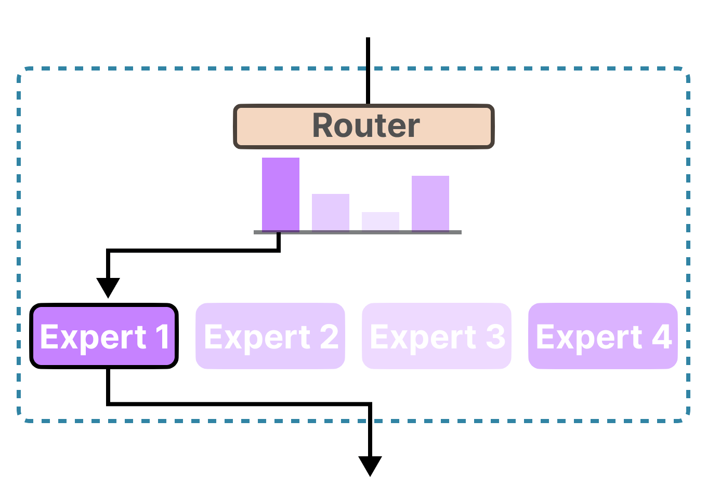

в этой статье будет описан опыт запуска qwen 3.8 flash next (модель на 125B параметров) на моем пк используя движек [strata](https://github.com/niko1221/strata).

для начала немного про пк на которых я запускал.

шиз пк:

* CPU: 2x xeon e5 2698 v4
* GPU: intel arc b580 12gb
* RAM: 64gb ecc ddr4

норм пк:

* CPU: intel i7 10700f
* GPU: nvidia rtx 3060 12gb
* RAM: 64gb ddr4

скорости генерации (квант IQ3_XXS):

| ПК | генерация | чтение |
| -------- | -------- | -------- |
| норм пк | 30-50 т/c | 400-500 т/с |
| шиз пк | 30-40 т/c | 400-500 т/с |

пк относительно нормальные если не обращать внимание на объему ОЗУ это единственно отличие от обычного пк.

но в любом случае это все равно самый дешевый вариант для локального запуска модели такого размера.

что же разберем как это стало возможно.

для начала это стало возможно благодаря [ISTA-DASLab](https://huggingface.co/ISTA-DASLab) которые квантовали модель [Qwen3.8-Flash-Next-GSQ-RCO-GGUF](https://huggingface.co/ISTA-DASLab/Qwen3.8-Flash-Next-GSQ-RCO-GGUF) (по мимо этой модели есть ещё [DeepSeek-V4.1-Flash](https://huggingface.co/ISTA-DASLab/DeepSeek-V4.1-Flash-1017-GSQ-RCO-GGUF), [Qwen3.8-27B](https://huggingface.co/ISTA-DASLab/Qwen3.8-27B-GSQ-RCO-GGUF)). 

вкратце рассмотрим как проходило квантование модели:


в репозитории представлены следующие кванты: Q2_0, IQ2_XS, IQ3_XXS, IQ3_S.
и у любого кто запускал квантованыне модели назревает вопрос какой смысл в модели с квантизацией больше IQ4 ведь они будут нести бред и уходить в циклы.

это стало возможно благодаря двум методам [GSQ](https://github.com/IST-DASLab/GSQ)-[RCO](https://github.com/IST-DASLab/RCO) которые если в кратце опытным путем разпределяют уровень квантизации в зависимости от важности слоя и в среднем как раз таки выходит Q2-Q3 квантизация. это уменьшает размер модели до 66-83гб

# TODO подробней расписать как это работает

благодаря квантизации модель можно загрузить в оперативную память но не как не в видеокарту (по крайней мере не в потребительскую) но и для этой проблемы есть решение. qwen 3.8 next flash это модель архитектуры MoE (Mixture of Experts)

если упрощать под капотом модель представляет из себя сборище из маленьких моделей - экспертов. при этом при генерации токенов единомоменто используется только 10 экспертов которые по оценки аркестратора лучше всего потходят и я думаю решение напрашивается само собой держать в памяти видеокарты только активных экспертов. 

естественно у многих должен созреть вопрос если я могу позволить себе потратить 50+ к на оперативку то наверное и на подписку для claude, kimi, deepseek, codex и т.д. наскребсти смогу.

и вы будите правы более того скорость генерации у облачных сервисов выше (около 80 т/с) так кому это может понадобится?

1. корпоративный приватный ИИ. если вы работаете с каким либо видом "тайны" то вы не можете использовать обычные сервисы и разворачивание модели локально может быть выходом (особенно если выделят железо по лучше с несколькими картами)
2. 
