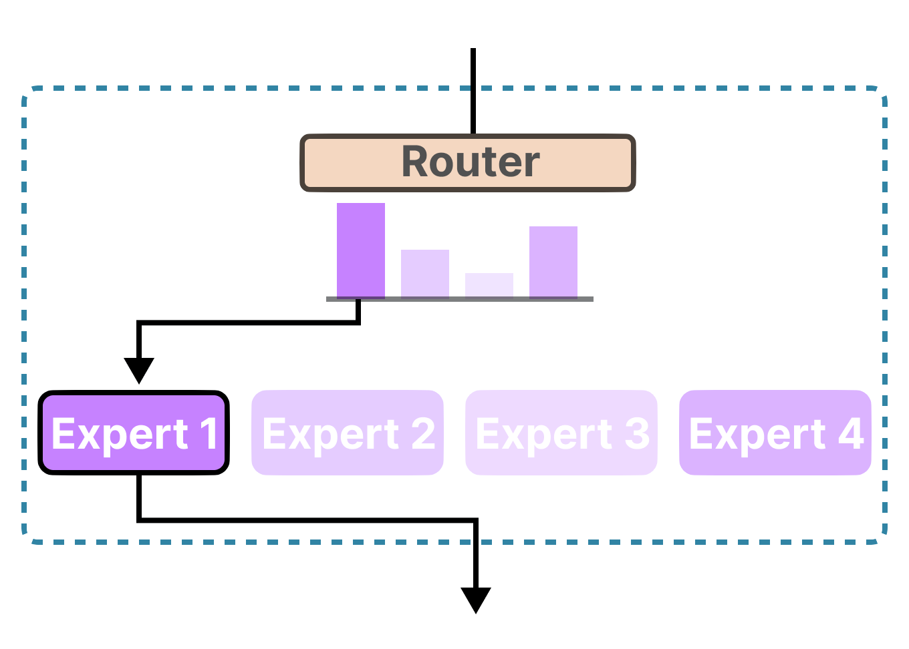

в этой статье будет описан опыт запуска qwen 3.8 flash next (модель на 125B параметров) на моем пк с использованием движка [strata](https://github.com/niko1221/strata).

для начала немного про пк, на которых я запускал.

шиз-пк:

* CPU: 2x xeon e5 2698 v4
* GPU: intel arc b580 12gb
* RAM: 64gb ecc ddr4

норм-пк:

* CPU: intel i7 10700f
* GPU: nvidia rtx 3060 12gb
* RAM: 64gb ddr4

скорости генерации (квант IQ3_XXS):

| ПК | генерация | чтение |
| -------- | -------- | -------- |
| норм-пк | 30-50 т/с | 400-500 т/с |
| шиз-пк | 30-40 т/с | 400-500 т/с |

[бенчмарки на других сборках](https://github.com/Niko1221/Strata/blob/main/docs/COMMUNITY_BENCHMARKS.md)

пк относительно нормальные: если не обращать внимание на объем ОЗУ, это единственное отличие от обычного пк.

но в любом случае это все равно самый дешевый вариант локального запуска модели такого размера.

что же, разберем, как это стало возможно.

для начала это стало возможно благодаря [ISTA-DASLab](https://huggingface.co/ISTA-DASLab), которые квантовали модель [Qwen3.8-Flash-Next-GSQ-RCO-GGUF](https://huggingface.co/ISTA-DASLab/Qwen3.8-Flash-Next-GSQ-RCO-GGUF) (помимо этой модели есть ещё [DeepSeek-V4.1-Flash](https://huggingface.co/ISTA-DASLab/DeepSeek-V4.1-Flash-1017-GSQ-RCO-GGUF), [Qwen3.8-27B](https://huggingface.co/ISTA-DASLab/Qwen3.8-27B-GSQ-RCO-GGUF)).

вкратце рассмотрим, как проходило квантование модели:



в репозитории представлены следующие кванты: Q2_0, IQ2_XS, IQ3_XXS, IQ3_S.
и у любого, кто запускал квантованные модели, назревает вопрос: "какой смысл в квантизации ниже IQ4, ведь такие модели несут бред и уходят в циклы?"

это стало возможно благодаря двум методам — [GSQ](https://github.com/IST-DASLab/GSQ) и [RCO](https://github.com/IST-DASLab/RCO), которые, если вкратце, опытным путем распределяют уровень квантизации в зависимости от важности слоя, и в среднем как раз выходит Q2-Q3 квантизация. это уменьшает размер модели до 66-83 ГБ.

разберем чуть подробней.

обычная "равномерная" квантизация наивна: одно и то же число бит достается всем тензорам, хотя чувствительность у слоев разная — где-то можно смело отрезать почти все биты, а где-то каждый бит на счету. GSQ и RCO решают это в два этапа:

* **[GSQ](https://github.com/IST-DASLab/GSQ)** (Gumbel-Softmax Quantization) — post-training скалярная квантизация. для каждого тензора она дифференцируемо (через gumbel-softmax релаксацию) учит и то, куда попадает каждое значение на сетке уровней, и масштабы групп. за счет этого на 2-3 битах скалярная квантизация почти догоняет векторную по качеству, но при этом результат остается в стандартном GGUF формате.
* **[RCO](https://github.com/IST-DASLab/RCO)** (Riemannian Constrained Optimization) — уже чистая аллокация. после GSQ у каждого тензора есть K готовых вариантов с разным числом бит, и нужно выбрать по одному типу на тензор так, чтобы средний bpw попал в бюджет размера. ограничение на бюджет переформулируется в гладкое риманово многообразие в логит-пространстве, поэтому поиск идет градиентами прямо по лоссу задачи, и бюджет соблюдается точно, без ручной подгонки гиперпараметров.

в итоге процедура выглядит так: каждый из 352 тензоров модели квантуется всеми типами-кандидатами → RCO-поиск выбирает по одному типу на тензор под заданный бюджет → выбранное собирается в обычный GGUF файл.

и вот почему бреда не будет: на открытых бенчмарках IQ3_XXS (3.0 bpw) сохраняет 99.4% качества базовой модели, а IQ3_S местами даже обгоняет оригинал. так что модель не несет бред

благодаря квантизации модель можно загрузить в оперативную память, но никак не в видеокарту (по крайней мере не в потребительскую). но и для этой проблемы есть решение: qwen 3.8 flash next — это модель архитектуры MoE (Mixture of Experts)

если упрощать, под капотом модель представляет из себя сборище из маленьких моделей — экспертов. при этом при генерации токенов одномоментно используется только 10 экспертов (из 512) — те, которые по оценке оркестратора лучше всего подходят. и я думаю, решение напрашивается само собой: держать в памяти видеокарты только активных экспертов.

и последняя немаловажная деталь — это спекулятивная генерация (предсказание нескольких токенов за раз). в strata ее реализуют MTP и dflash, схема называется 2drafter, и она ускоряет генерацию в несколько раз.

тут тоже разберемся по порядку.

обычная авторегрессия неэффективна: один полный проход большой модели = один токен, и скорость упирается в чтение весов из памяти. спекулятивная генерация меняет схему: маленький и дешевый "черновик" (drafter) за копейки предлагает сразу несколько токенов подряд (окно до 8), а большая модель проверяет их все за один проход — правильные принимает, хвост ошибочных отбрасывает и продолжает с последнего принятого. в итоге один дорогой проход приносит в среднем несколько токенов, а не один.

в strata на эту роль есть два драфтера (потому и схема называется 2drafter):

* **MTP** (multi-token prediction) — дополнительный слой прямо в основной модели (~1 ГБ), который при ее обучении отдельно учили предсказывать сразу несколько следующих токенов. отдельная модель не нужна.
* **[dflash2](https://inco.ai/blog/dflash2/)** — отдельная крошечная drafter-модель (~0.7-0.9 ГБ в q4), которую strata тянет параллельно и может сама подбирать под железо.

естественно, у многих должен созреть вопрос: если я могу позволить себе потратить 50+к на оперативку, то, наверное, и на подписку для claude, kimi, deepseek, codex и т.д. наскрести смогу.

и вы будете правы: это нужно далеко не всем. более того, скорость генерации у облачных сервисов выше (около 80 т/с). так кому это может понадобиться?

1. корпоративный приватный ИИ. если вы работаете с каким-либо видом "тайны", то вы не можете использовать обычные сервисы, и разворачивание модели локально может быть выходом (особенно если выделят железо получше, с несколькими картами)
2. если вы любитель пошалить, то запуск [uncensored](https://huggingface.co/rSalone/Qwen3.8-Flash-Next-GSQ-RCO-uncensored-q8g-GGUF) моделей
3. могу и буду запускать!
