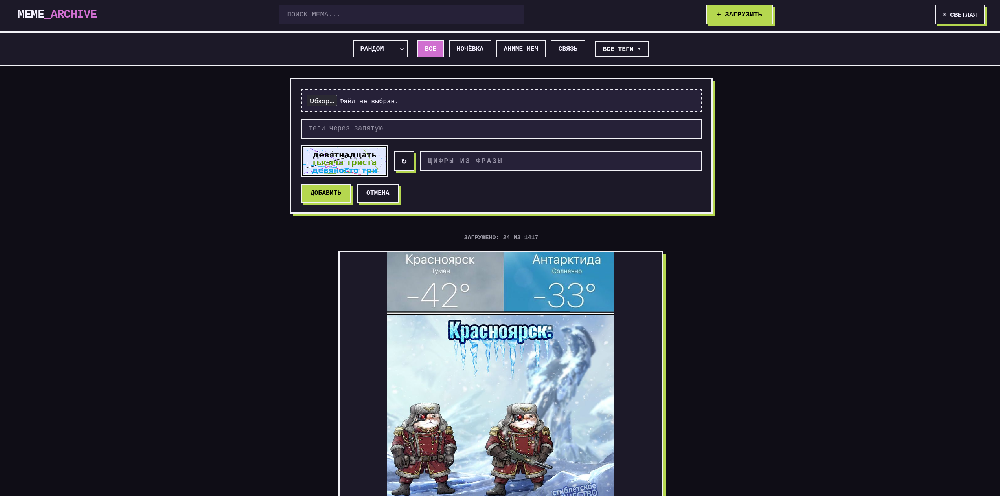
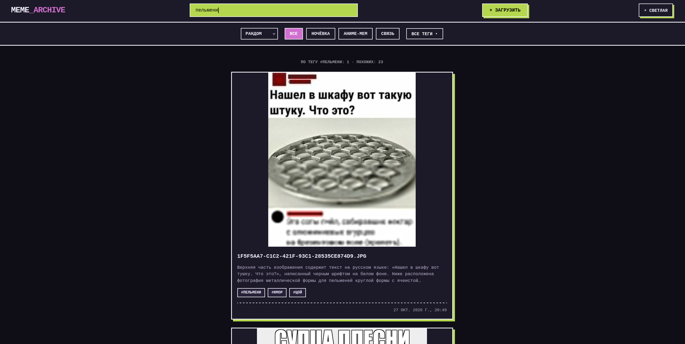

> *это не объявление войны. мы не Танаки, но знаем, как поработить мир.*

> Мы хотим представить вам свой меморандум. здесь вас сможет рассмешить даже случайная картинка, то есть своего рода мемо-рандом. и в ней достаточно лишь одного панчлайна — one-punch-meme. хохочешь с картинок окру? в реестре мемов есть фотожабы повыше рангом. при нас не говори про кризис двадцати — мы пережили кризис двадцатых.

> Кто мы без смешных фотокарточек? Как ещё мы можем проявить остроумие и “текстовую харизму”, если не без отправленных ржомб в точно подобранный момент? МемАрхив Потатома решает эту проблему. Деление по категориям, нейроописание, тэги - всё это делает поиск и сортировку мемов намного удобнее. Ищешь нужный мем..? Вуаля! Я чё упоротый? Присоединяйся и ты! Вместе построим МЕМОРИАЛ из обломков десятых годов, пабликов вк, двачей, реддитов и мем-культуры. — l0cal8

---

Кажется, я где-то это читал или тут было что-то подобное... И да, так и есть. Раньше мы даже запускали поток смешных хихи-хаха в прод, но потом все загнулось: сервера прогнили, мемы испарились... Но проект то прикольный! и я решил довести его до ума. За основу была взята первая версия на Python, где кроме индексации мемов и поиска по уже индексированным ничего не было сделано.

Opencode с превеликим удовольствием прикрутил мне весь функционал.

## Как все работает?

1. Байты изображения конвертируются в хеш sha256, который в свою очередь является ID изображения. 
2. После загрузки изображение описывается моделью Gemini, описание превращается в эмбеддинг и сохраняется в ChromaDB. Добавляются теги.
3. При запросе на поиск - поиск идёт через embending-модель по смыслу запроса, а не по именам файлов.
4. После поиска создается кэш эмбеддингов запросов (точный + fuzzy через rapidfuzz), сохраняется в SQLite.

## Основные функции

- Загрузка изображений через веб-интерфейс и API.
- Автоматическое описание мема (Gemini) и семантический поиск.
- Лента всех мемов с ленивой подгрузкой и отдельные карточки мемов.
- Теги для каждого мема с автодобавлением при индексации.
- Капча на загрузку (собственная отрисовка через Pillow, без внешних сервисов).
- Модерация загрузок: мем попадает в очередь, админ получает уведомление в Telegram, через час публикуется автоматически, если его не отклонили.
- Переиндексация при смене модели эмбеддингов.

## Telegram бот

Телеграм бот `@mem_archive_bot` может искать мемы аналогично, как и на сайте. Есть inline режим для поиска мемов прям в любом чате - `@mem_archive_bot <что ищем>`. 

## Кожанные прокси, которые принимали участие

[SCH](https://potatom.net/sch) - нанюхался того самого и написал основу

[Bork](https://potatom.net/bork) - при участии opencode прикрутил на основу что-то полезное и сделал тг бота

[driklina](https://github.com/driklina) - UX/UI, сделала нам визуал

[l0cal8](https://potatom.net/local8) - породил словестный потоп и эмоционально утомлял SCH во время разработки

## Картинки

Форма для загрузки мема

Поиск по запросу

## Стек
{: .comment }
- **Python**{: .meta }
  Язык программирования.
- **ChromaDB**{: .meta }
  Векторная база данных.
- **Aiogram**{: .meta }
  Telegram Bot API.
- **Gemini**{: .meta }
  Модель для описания и embending'а.
{: .grid }
